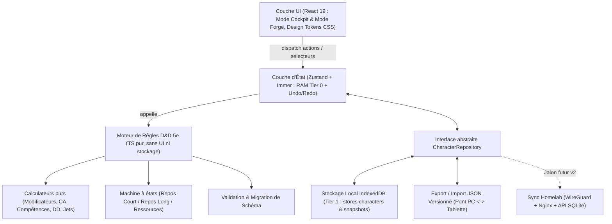

# Architecture Technique — Grimoire 5e

Stack : **React 19 + TypeScript 5 (`strict`) + Vite + Zustand & Immer + IndexedDB + Vitest + PWA (`vite-plugin-pwa`)**.



**Principe clé** : Le moteur métier (`src/engine/`) ne connaît ni React, ni le DOM, ni `IndexedDB`. Il ne stocke que les **données sources** dans l'état et calcule toutes les **valeurs dérivées** (modificateurs, totaux de compétences, bonus d'attaque, DD) via des fonctions pures déterministes (`état -> statistiques calculées` et `état + action -> nouvel état`), intégralement testées unitairement avec Vitest.

---

## 1. Structure des dossiers
```text
src/
  engine/       types.ts, glossary.ts, rules.ts, calculators.ts, rest.ts, dice.ts, validators.ts, migrations.ts, *.test.ts
  state/        store.ts, repository.ts, indexeddb-adapter.ts, backup-service.ts, history.ts
  ui/
    components/ common/, cockpit/, forge/, dice-assistant/, snapshots/
    views/      CharacterSheetView.tsx, CharacterListView.tsx
    hooks/      useDerivedCharacter.ts, useUndoRedo.ts
  theme/        tokens.css, base.css, utilities.css
```

---

## 2. Modèle de données (Esquisse TypeScript)
```ts
export type AbilityKey = 'STR' | 'DEX' | 'CON' | 'INT' | 'WIS' | 'CHA';
export type ProficiencyLevel = 'none' | 'half' | 'proficient' | 'expertise';
export type RecoveryTiming = 'short_rest' | 'long_rest' | 'manual';
export type HitDieSize = 6 | 8 | 10 | 12;
export type TermDisplayMode = 'bilingual' | 'fr' | 'en';
export type ThemeMode = 'light' | 'dark';

export interface BilingualNamed {
  id: string;
  name: string;                     // Libellé principal (ex: "Escamotage", "Foulée brumeuse", "Guerrier")
  originalName?: string;            // Terme VO/VF secondaire optionnel (ex: "Sleight of Hand", "Misty Step", "Fighter")
}

export interface CharacterClassEntry extends BilingualNamed {
  subclass?: {
    name: string;                   // ex: "Maître de guerre"
    originalName?: string;          // ex: "Battle Master"
  };
  level: number;                    // Niveau dans cette classe (le niveau global est la somme)
  hitDieSize: HitDieSize;           // Dé de vie associé à cette classe
  spellcastingAbility?: AbilityKey; // Caractéristique d'incantation/capacité propre à cette classe
}

export type HitDicePools = Record<HitDieSize, {
  total: number;                    // Dérivé de la somme des niveaux des classes de ce type de dé
  available: number;                // Dés restants à dépenser en Repos Court
}>;

export interface SkillDefinition extends BilingualNamed {
  ability: AbilityKey;
  proficiency: ProficiencyLevel;
  bonusFlat: number;                // Modificateur additionnel éventuel (objet, mutation, etc.)
  isCustom: boolean;
}

export interface TrackedResource extends BilingualNamed {
  current: number;
  max: number;
  recovery: RecoveryTiming;
}

export interface CharacterSheetV1 {
  schemaVersion: 1;
  id: string;
  updatedAt: string;                // ISO 8601 (prépare la réplication future)
  revision: number;                 // Compteur monotone incrémenté à chaque mutation
  preferences?: {
    termDisplayMode: TermDisplayMode; // 'bilingual' par défaut ("Discrétion · Stealth")
    theme?: ThemeMode;                // 'light' par défaut ("Ivoire & Encre"), commutable en 'dark'
  };
  identity: {
    name: string;
    portraitDataUrl?: string;       // Portrait du personnage (Data URL WebP/JPEG redimensionnée côté client, ex. max 512x512)
    classes: CharacterClassEntry[]; // Support natif du multi-classage (1 à N classes)
    background: string;
    ancestry: string;
  };
  abilities: Record<AbilityKey, number>;
  savingThrowProficiencies: Record<AbilityKey, boolean>;
  skills: SkillDefinition[];
  combat: {
    hpCurrent: number;
    hpMax: number;
    hpTemp: number;
    armorClassBase: number;
    armorClassBonus: number;
    speed: number;
    initiativeBonusFlat: number;
    hitDicePools: HitDicePools;     // Réserves de Dés de Vie par taille (d6, d8, d10, d12)
    deathSaves: { successes: number; failures: number };
    exhaustionLevel: 0 | 1 | 2 | 3 | 4 | 5 | 6;
    conditions: string[];
  };
  resources: TrackedResource[];
  attacks: Array<{
    id: string;
    name: string;
    originalName?: string;          // Terme VO/VF secondaire optionnel
    ability: AbilityKey;
    proficient: boolean;
    attackBonusFlat: number;
    damageFormula: string;          // ex: "2d6"
    damageType: string;             // ex: "Balistique", "Slashing", "Radiant"
    range: string;
    ammoResourceId?: string;
    notes: string;
  }>;
  spellcasting?: {
    defaultAbility: AbilityKey;
    slots: Record<number, { max: number; used: number }>;     // Emplacements standards 1-9 (Repos Long)
    pactSlots?: { level: number; max: number; used: number }; // Emplacements de Pacte (Repos Court)
    abilitiesList: Array<{
      id: string;
      level: number;
      name: string;                 // ex: "Foulée brumeuse" ou "Eldritch Blast"
      originalName?: string;        // ex: "Misty Step"
      ability?: AbilityKey;         // Surcharge par classe en cas de multi-classage d'incantateurs
      prepared: boolean;
      castingTime: string;
      range: string;
      description: string;
    }>;
  };
  inventory: Array<{
    id: string;
    name: string;
    originalName?: string;
    quantity: number;
    weight: number;
    equipped: boolean;
    notes: string;
  }>;
  notes: string;
}

export interface CharacterSnapshot {
  snapshotId: string;
  characterId: string;
  createdAt: string;
  label: string;              // ex: "Auto - Avant Repos Long" ou "Niveau 5 validé"
  payload: CharacterSheetV1;
}
```

---

## 3. Stratégie de Persistance, Cache & Backup (Parallèle Infra / Stockage)
- **Tier 0 — Mémoire Vive (`Zustand` + `Immer`)** :
  Chaque action utilisateur produit un nouvel état immuable par partage structurel (*Copy-on-Write* en RAM). Une pile circulaire conserve les *N* derniers pointeurs d'état pour offrir un **Undo/Redo instantané** en cas de fausse manipulation tactile.
- **Tier 1 — Stockage Local Transactionnel (`IndexedDB`)** :
  - **Store `characters`** : Persistance automatique en mode *Write-Behind* (écriture différée de ~250 ms après la dernière mutation pour éviter l'amplification d'écriture lors de clics rapides sur les PV).
  - **Store `snapshots`** : Points de restauration immuables locaux (créés manuellement ou automatiquement avant un Repos Long).
- **Tier 2 — Sauvegarde Externe & Synchronisation (`JSON` puis `Homelab`)** :
  - **En v1** : Export et import de fichiers `.json` encapsulant la fiche, son numéro de révision, son horodatage et sa version de schéma (`schemaVersion: 1`).
  - **Préparation Homelab (v2)** : Toute la persistance passe par le contrat `CharacterRepository`. Les champs `updatedAt` et `revision` sont déjà présents sur chaque fiche pour permettre plus tard une réplication vers un conteneur Homelab derrière Nginx et VPN WireGuard sans modifier le modèle métier.

---

## 4. Sécurité & Chaîne de Build
- **Validation stricte aux frontières** : Tout objet lu depuis `IndexedDB` ou depuis un fichier `.json` importé passe par le validateur du moteur (`validateCharacterPayload`) avant d'entrer dans le store React. Aucune exécution de code dynamique ni d'injection HTML (`dangerouslySetInnerHTML` interdit).
- **Zéro secret côté client** : Aucune clé ni URL interne en dur dans le code source.
- **Build & Qualité** : TypeScript `strict: true`, `noUncheckedIndexedAccess: true`, `exactOptionalPropertyTypes: true`, tests unitaires Vitest sur 100 % des règles de `src/engine/`, Linter strict.
